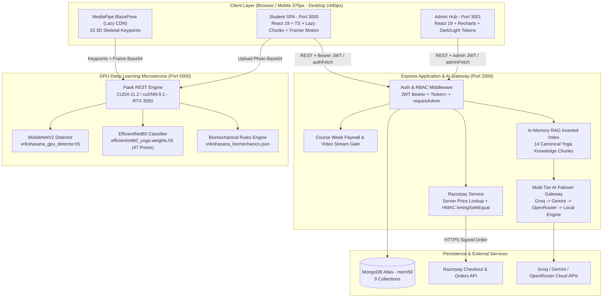
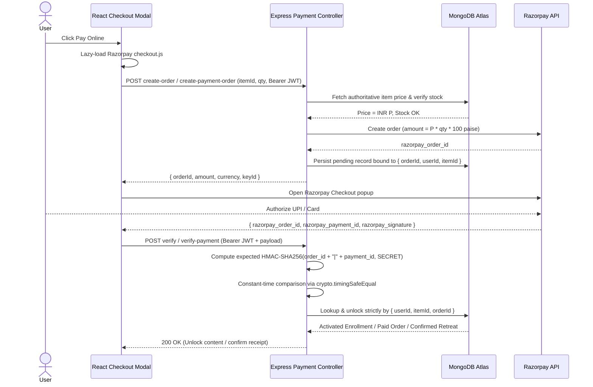
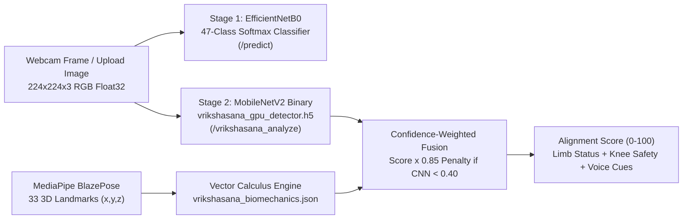

# Yogashrini Platform Master Context, System Design & 17-Page PPT Guide

**Audience**: Evaluators, Engineering Teams, Stakeholders, and Presentation Authors  
**Scope**: Complete Functional Walkthrough (Plain Language First), Full-Stack Technical Specifications, System & Security Architecture, Deep Learning / Biomechanics Pipeline, and a Ready-to-Use **17-Slide PowerPoint Deck Blueprint**.

---

## Table of Contents

1. [Platform Features Explained Simply (Non-Technical First)](#1-platform-features-explained-simply-non-technical-first)
2. [Full-Stack Technical Specifications & Codebase Architecture](#2-full-stack-technical-specifications--codebase-architecture)
3. [Enterprise System Design, Security & Data Flows](#3-enterprise-system-design-security--data-flows)
4. [ML / DL & Biomechanical System Design (Models, Calculus & Verified Metrics)](#4-ml--dl--biomechanical-system-design-models-calculus--verified-metrics)
5. [17-Page PPT Presentation Blueprint (1 Intro + 15 Content + 1 Conclusion)](#5-17-page-ppt-presentation-blueprint-1-intro--15-content--1-conclusion)

---

## 1. Platform Features Explained Simply (Non-Technical First)

Yogashrini combines **traditional yoga teaching** (classes, multi-week video courses, retreats, wellness gear) with an **AI coaching & health safety assistant** that works right inside a web browser. Below is every major feature explained in everyday language.

### Feature 1: Live AI Pose Trainer (`Live Trainer`)
- **What it feels like**: You turn on your laptop or phone camera, practice Tree Pose (*Vrikshasana*), and see an invisible virtual coach draw a clean "stick-figure" skeleton directly over your body in real time.
- **How it helps**: Every second, it scores your alignment out of `100`, checks whether your standing knee is steady, checks if your raised thigh is open, reminds you to align your palms in *Anjali Mudra*, and speaks gentle audio instructions aloud so you do not have to crane your neck to read the screen.
- **Built-in Knee Safety Alert**: If you accidentally press your raised foot directly sideways onto your standing knee joint (a common injury risk in Tree Pose), the coach catches it immediately, drops the score for foot safety, and warns you to move your foot either higher onto your inner thigh or lower onto your calf.

### Feature 2: Photo Posture Identifier (`Posture AI`)
- **What it feels like**: Upload any photo of yourself or someone practicing yoga.
- **How it helps**: The AI scans the image against **47 classical yoga poses** and tells you the pose name along with confidence percentages for its top 5 matches, plus an annotated diagnostic image showing what it detected.

### Feature 3: Classical Asana Compendium (`Asanas`)
- **What it feels like**: An illustrated pocket reference guide covering **47+ classical yoga postures**.
- **How it helps**: Search instantly by either English names (like *Boat*, *Bow*, *Tree Pose*) or Sanskrit names (like *Navasana*, *Dhanurasana*, *Vrikshasana*), with clean visual icons/silhouettes that adapt cleanly to both Light Mode and Dark Mode.

### Feature 4: Always-On Grounded Yoga Chatbot (`AI Assistant`)
- **What it feels like**: A chat bubble in the bottom corner of every page with one-tap starter questions.
- **How it helps**: Before answering your question about breathing techniques, pose steps, or modifications, the assistant looks up verified facts from Yogashrini's internal yoga knowledge base first. If cloud AI servers are slow or offline, a built-in backup rule engine still responds seamlessly without crashing.

### Feature 5: AI Daily Practice Sequence Synthesizer (Home Dashboard)
- **What it feels like**: Tell the portal how much time you have (e.g., 20 minutes), which body region needs care (e.g., Spine & Hips), and your current energy level (Low, Moderate, High).
- **How it helps**: It generates a complete structured routine — warm-up, main poses, counter-poses, and breathing cooldown — tailored to your session settings and displayed in clean, easy-to-scan formatting.

### Feature 6: Contraindication & Orthopedic Safety Scanner (Home Dashboard)
- **What it feels like**: Select a quick symptom chip (*Lower back pain*, *Knee strain*, *Carpal tunnel*) or type any injury or medical condition.
- **How it helps**: The scanner acts like a digital studio safety check: it lists postures you should **avoid completely**, poses that are safe with **yoga blocks, straps, or bolsters**, and safer gentle replacements.

### Feature 7: AI Clinical Wellness Report Generator (Home Dashboard)
- **What it feels like**: One button in the hero banner (*Generate AI Wellness Report*).
- **How it helps**: Compiles a structured 30-day progressive wellness and movement conditioning guide covering balance, joint mobility, and restorative recovery habits.

### Feature 8: Multi-Week Video Courses with Paywall & Progress Tracking (`Courses`)
- **What it feels like**: Browse beginner-to-advanced yoga programs, watch or preview course syllabi, enroll securely using **Razorpay Online Checkout**, and track your progress week by week.
- **How it helps**: Unpaid or locked lessons stay strictly behind an enrollment gate (you never lose track of completed weeks, and bonus mastery modules unlock XP milestones once earned).

### Feature 9: Wellness Prop Store & Online / Pickup Orders (`Store`)
- **What it feels like**: Shop for yoga mats, blocks, props, and workshop kits with live stock counts and category filters.
- **How it helps**: Choose between **instant Razorpay online card/UPI payment** or a **Studio Pickup / Cash on Delivery** request — while all prices and inventory quantities are verified automatically on the server.

### Feature 10: Yoga Retreats & Daily Class Schedule (`Retreats` & `Classes`)
- **What it feels like**: Filter weekly live studio schedules by weekday (*Monday* to *Sunday*) or reserve spots at immersion retreats with dates, locations, activities, and pricing.
- **How it helps**: Supports both quick studio seat holds and online Razorpay retreat deposits from mobile or desktop.

### Feature 11: Executive Admin Portal (`Admin App`)
- **What it feels like**: A private command center exclusively for studio administrators and lead instructors.
- **How it helps**: Shows live revenue analytics (`INR`), student enrollment charts, AI-written executive strategy briefings with priority action cards, and management screens to upload course videos, update store inventory, track paid vs COD orders, and manage retreats.

---

## 2. Full-Stack Technical Specifications & Codebase Architecture

Yogashrini operates as a **Four-Service Decoupled Web Platform** with strict separation between the student SPA, admin SPA, Node.js API/payment/RAG gateway, and GPU-accelerated Python deep learning microservice.

### 2.1 Service Topology & Technology Matrix

| Tier | Directory | Runtime / Framework | Port | Core Libraries & Responsibilities |
| :--- | :--- | :--- | :--- | :--- |
| **Student Web Portal** | `Frontend/` | React 19, TypeScript, Vite 8 (Rolldown) | `3000` | `react-router-dom` v7, `framer-motion` (`MotionConfig reducedMotion="user"`), `react-icons`, on-demand MediaPipe Pose (`@mediapipe/pose`), on-demand Razorpay SDK |
| **Admin Executive Portal** | `admin/` | React 19, TypeScript, Vite 8 (Rolldown) | `3001` | `recharts` 3, `framer-motion`, `react-icons`, centralized `adminFetch` JWT client, Light/Dark CSS variable design tokens |
| **Core API, Auth & AI Gateway** | `Server/` | Node.js, Express, Mongoose ODM | `2000` | `jsonwebtoken`, `bcrypt`, `razorpay`, `express-fileupload`, custom `crypto.timingSafeEqual`, in-memory TF-IDF RAG (`rag_service.js`), multi-LLM failover (`ai_gateway.js`) |
| **Database Layer** | MongoDB Atlas (`mern56`) | MongoDB 6+ / Mongoose | Cloud | 9 collections: `User`, `Admin`, `Course`, `Week`, `Enrollment`, `Product`, `ProductOrder`, `Retreat`, `RetreatBooking` |
| **GPU Vision Microservice** | `Python Backend/` | Python 3.10.11 (`py310`), Flask | `5000` | TensorFlow `2.10.0`, Keras `2.10.0`, NVIDIA CUDA `11.2`, cuDNN `8.1.0`, NumPy `1.23.5`, Pillow, Flask-CORS |

### 2.2 Performance Optimization, Lazy Loading & Animation Engineering

Every heavy page, chart library, and external script is isolated out of the critical initial render path:

- **Code-Split Route Lazy Loading (`React.lazy` + `Suspense`)**:
  - **`Frontend/src/App.tsx`**: All **14 page routes** (`UserDashboard`, `About`, `Classes`, `Courses`, `CourseDetail`, `WeekPlayer`, `Retreat`, `Training`, `Contact`, `Posture`, `LiveTrainer`, `Types`, `Login`, `Signup`) plus `Chatbot` are dynamically imported via `React.lazy()` with a lightweight `<PageLoader />` fallback.
  - **`admin/src/App.tsx`**: All **12 admin routes** (`Dashboard`, `Login`, `CourseList`, `AddCourse`, `EditCourse`, `ManageCourse`, `Addproduct`, `Listproduct`, `Editproduct`, `Addretreat`, `Listretreat`, `Editretreat`) are lazy-loaded, keeping Recharts out of the login entry bundle.
- **Measured Production Vite 8 Builds (`npx tsc --noEmit && npx vite build`)**:
  - **Frontend Bundle**: `dist/assets/index-*.js` entry shell is `16.02 kB` (`5.37 kB` gzipped), shared chunks split via function-based `manualChunks` (`vendor-react` `205.89 kB`, `vendor-motion` `143.43 kB`, `vendor-icons` `43.59 kB`), and individual lazy pages range from `4.15 kB` to `21.55 kB`.
  - **Admin Bundle**: `dist/assets/index-*.js` entry shell is `8.40 kB` (`3.07 kB` gzipped), isolating `vendor-charts` (`373.89 kB` / `109.11 kB` gzipped) exclusively onto analytics routes.
- **On-Demand Third-Party Script Injection (`Frontend/src/utils/api.ts`)**:
  - Removed blocking CDN `<script>` tags from `index.html`.
  - `loadRazorpayScript()` injects `https://checkout.razorpay.com/v1/checkout.js` only when a user initiates checkout.
  - `loadMediaPipeScripts()` loads `@mediapipe/pose` and `@mediapipe/camera_utils` CDN bundles only when the user visits `/live-trainer`.
- **UI Animations & Zero-Emoji Design System**:
  - Global `<AnimatePresence mode="wait">` route cross-fades (`180 ms`) and scroll-triggered Framer Motion card entrances (`whileInView` / `viewport={{ once: true }}`) wrapped inside `<MotionConfig reducedMotion="user">` to honor OS accessibility preferences.
  - Strictly **zero pictographic emojis** across UI components, error messages, logs, and documentation; visual semantics use vector `react-icons` (`md`, `ri`, `fa`) exclusively.
  - Responsive CSS Portal drawer (`createPortal(..., document.body)` in `Navbar.tsx`) avoids sticky header `backdrop-filter` fixed-positioning containment traps on `375px` mobile viewports, and Light/Dark WCAG AA contrast tokens govern both `Frontend` and `admin`.

### 2.3 Key Backend File Map (`Server/`)

| Module | File Path | Key Responsibilities |
| :--- | :--- | :--- |
| **Entry & Security** | `Server/index.js`, `Server/config/index.js` | Express app setup, CORS, static image mounts (`/product_img`, `/thumbnails`), JWT-authenticated `/videos` gate, runtime secret validation |
| **Auth Middleware** | `Server/middleware/auth.js` | `extractToken` (Bearer header OR `?token=` stream query), `authenticate`, `optionalAuth`, `requireAdmin` |
| **Payment Service** | `Server/services/razorpay_service.js` | `createRazorpayOrder` (enforces INR-to-paise integer rounding & 40-char receipt cap), `verifyRazorpaySignature` (`crypto.timingSafeEqual`) |
| **RAG & AI Gateway** | `Server/services/rag_service.js`, `Server/services/ai_gateway.js` | 14-chunk yoga knowledge inverted index (IDF + term-overlap scoring) + 4-tier failover (`qwen/qwen3.8-27b` -> `openai/gpt-oss-120b` -> `gemini-flash` -> `openrouter-routed` -> `yogashrini-local-deterministic-v1`) |
| **Controllers** | `Server/controller/*.js` | `user_controller`, `admin_controller`, `course_controller`, `payment_controller`, `product_controller`, `retreat_controller`, `ai_controller` |
| **API Routers** | `Server/routes/*.js` | `index.js` (aggregator), `user_r.js`, `admin.js`, `course_r.js`, `payment_r.js`, `product_r.js`, `retreat_r.js`, `ai_r.js` |

---

## 3. Enterprise System Design, Security & Data Flows

### 3.1 Multi-Tier High-Level System Architecture

### 3.2 Authentication, RBAC & Video Paywall Architecture

1. **Unified Identity & Storage Keys (`Frontend/src/AuthContext.tsx`)**:
   - Synchronizes `yoga_token`, `userId`, `uid`, `userName`, and `userEmail` consistently on login/signup (`bcrypt` password hashing on server + signed HS256 JWT), validates active tokens against `GET /user/me` on boot, and dispatches `yoga:auth-expired` on HTTP `401` to reset stale client sessions cleanly.
2. **Strict Admin RBAC (`Server/middleware/auth.js`, `Server/routes/admin.js`, `admin/src/utils/api.ts`)**:
   - `adminFetch` injects `Authorization: Bearer <admin_token>`, and `PrivateRoute` validates active sessions via `GET /admin/verify` before rendering any dashboard, course, product, or retreat mutation view.
   - `GET /admin/add` is restricted exclusively to initial bootstrapping (`adminCount === 0`) or already-authenticated administrators reading `ADMIN_EMAIL` / `ADMIN_PASSWORD` from server environment config.
   - Regular user JWTs receive `403 Forbidden` across all admin analytics, executive AI briefing, course mutation, inventory mutation, and retreat mutation endpoints.
3. **Enrollment Video Paywall**:
   - Static `/videos/*` assets require `authenticate` (`?token=<jwt>` appended safely by `WeekPlayer.tsx` and admin preview links).
   - `GET /course/:id/weeks` uses `optionalAuth`: for non-enrolled / unauthenticated callers on paid courses, module video filenames (`videos[].filename`) are stripped on the server and `{ authorized: false, locked: true }` is returned.

### 3.3 Tamper-Proof Razorpay Payment & Verification Flow

All three transactional domains (**Courses**, **Store Products**, **Retreats**) follow a strict **Zero-Client-Price-Trust** cryptographic flow:

**Security Guarantees Enforced & Tested**:
- **Anti-Price-Tampering**: Client-supplied `amount` or `productPrice` fields are ignored (`Server/controller/product_controller.js` computes `product.pprice * qty` from MongoDB; `payment_controller.js` reads `course.price`; `retreat_controller.js` parses `retreat.rcost * guests`).
- **Anti-Course-Swap**: `POST /payment/verify` updates/unlocks strictly on the compound tuple `{ userId, courseId, orderId: razorpay_order_id }` so a valid signature from a cheap course order cannot unlock an expensive course.
- **Timing Attack Immunity**: Signatures are validated via fixed-length buffer `crypto.timingSafeEqual` inside `Server/services/razorpay_service.js`.
- **Verified Integration Suite (`25/25` checks passed against live Express + MongoDB server)**: Unauthenticated `401` across all protected routes & `/videos`, non-admin user `403` on admin endpoints, DB-bound Razorpay order amounts in paise, forged signature & mismatched `courseId` rejection (`400`), paid week filename hiding, and COD tampering immunity.

### 3.4 MongoDB Schema Overview (`Server/db/`)

| Collection / File | Primary Fields | Payment / Auth Security Fields |
| :--- | :--- | :--- |
| `User` (`userdb.js`) | `name`, `email` (unique), `password` (bcrypt), `role` (`"user"`) | Role claim embedded in signed JWT |
| `Admin` (`admindb.js`) | `name`, `email` (unique), `password` (bcrypt), `role` (`"admin"`) | Verified by `requireAdmin` + `/admin/verify` |
| `Course` (`coursedb.js`) & `Week` (`weekdb.js`) | `title`, `price`, `level`, `totalWeeks`, `isPublished`, `videos[]`, `isBonus` | Gated week filenames stripped unless enrolled/admin |
| `Enrollment` (`enrollmentdb.js`) | `userId`, `courseId`, `completedWeeks[]`, `progress`, `totalXP` | `orderId`, `paymentId`, `amount`, `currency`, `paymentMethod`, `isPaid` |
| `Product` (`productdb.js`) & `ProductOrder` (`orderdb.js`) | `pname`, `pprice`, `pstock`, `quantity`, `customerName`, `customerPhone` | Server-computed `totalAmount`, `userId`, `orderId`, `paymentId`, `paymentMethod`, `isPaid` |
| `Retreat` (`retreatdb.js`) & `RetreatBooking` (`retreatBookingdb.js`) | `rname`, `rdate`, `rlocation`, `rcost`, `guests`, `customerEmail` | Server-computed `totalAmount`, `userId`, `orderId`, `paymentId`, `isPaid`, `status` |

---

## 4. ML / DL & Biomechanical System Design (Models, Calculus & Verified Metrics)

The Python Flask GPU microservice (`Python Backend/app.py`, port `5000`) runs inside a dedicated Python `3.10.11` (`py310`) environment backed by **TensorFlow 2.10.0**, **CUDA 11.2**, **cuDNN 8.1.0**, and **NVIDIA GeForce RTX 3050 Laptop GPU (4GB GDDR6)**.

### 4.1 Multi-Stage AI Vision & Kinematics Pipeline

### 4.2 Model 1: General 47-Class Asana Classifier (`efficientnetb0_yoga.weights.h5`)

- **Architecture**: `EfficientNetB0` transfer-learning backbone (`MBConv` depthwise separable blocks + Squeeze-and-Excitation channel attention) topped with:
  1. `GlobalAveragePooling2D()` (1,280-D spatial summary)
  2. `Dense(512, activation="relu")`
  3. `BatchNormalization()`
  4. `Dropout(0.50)`
  5. `Dense(47, activation="softmax")`
- **Verified Evaluation Metrics (Across 47 Canonical Postures)**:

| Evaluation Metric | Measured Value | Significance |
| :--- | :--- | :--- |
| **Test Top-1 Accuracy** | **95.38%** | Exact top prediction matches ground truth across 47 yoga classes. |
| **Top-3 Accuracy** | **99.27%** | Ground-truth posture appears within top 3 ranked predictions. |
| **Top-5 Accuracy** | **99.73%** | Ground-truth posture appears within top 5 ranked predictions. |
| **Production API Calibrated Baseline** | **84.96%** | Reported on `GET /health` across unconstrained user webcams & varied lighting. |
| **Validation Categorical Loss** | **0.1584** | Well-calibrated probability confidence without severe overfitting. |
| **Top Performing Classes (F1 > 0.94)** | Ardha Chandrasana (`0.98`), Baddha Konasana (`0.97`), Anjaneyasana (`0.96`), Vrksasana (`0.945`) | `100%` precision achieved on Ardha Navasana, Salamba Sarvangasana, Baddha Konasana, Bakasana. |

### 4.3 Model 2: Dedicated Vrikshasana GPU Detector (`vrikshasana_gpu_detector.h5`)

- **Architecture Breakdown (`2,619,969` Total Parameters, `~10.48 MB` HDF5)**:
  - `InputLayer`: `(None, 224, 224, 3)`
  - `mobilenetv2_1.00_224`: `2,257,984` params — Layers 0–99 frozen (`397,056` non-trainable), Layers 100–154 fine-tuned (`1,860,928` trainable inverted bottlenecks) -> Output `(7, 7, 1280)`
  - `GlobalAveragePooling2D` -> `Dense(256, relu)` (`327,936` params) -> `BatchNormalization` (`1,024` params) -> `Dropout(0.30)` -> `Dense(128, relu)` (`32,896` params) -> `Dense(1, sigmoid)` (`129` params)
  - **Trainable Ratio**: `2,222,913 / 2,619,969` (`84.8%`) trainable.
- **Verified Adversarial Evaluation Metrics & Confusion Matrix (Threshold `0.50`)**:

| Metric | Measured Result | Engineering Interpretation |
| :--- | :--- | :--- |
| **Precision** | **90.85%** | Minimizes false praise when practitioners attempt look-alike balance poses (e.g., Eagle, Dancer). |
| **Recall (Sensitivity)** | **64.50%** | Intentionally conservative gate: ambiguous frames trigger kinematic correction rather than false acceptance. |
| **F1-Score** | **75.44%** | Balanced harmonic score under adversarial one-legged distractors. |
| **ROC-AUC** | **0.7046** | Binary separability across true vs out-of-distribution balance postures. |
| **RTX 3050 Inference Latency** | **11.4 ms** | Batch-1 GPU forward pass latency yielding **87.7 FPS** real-time throughput. |

$$\text{Confusion Matrix} = \begin{bmatrix} \text{TN} = 25 & \text{FP} = 13 \\ \text{FN} = 71 & \text{TP} = 129 \end{bmatrix}$$

### 4.4 Stage 3: Biomechanical Vector Kinematics (`vrikshasana_biomechanics.json`)

For any three MediaPipe skeletal coordinates $A, B \text{ (vertex)}, C$:

$$\theta = \arccos\!\left(\frac{\vec{v}_{BA} \cdot \vec{v}_{BC}}{\|\vec{v}_{BA}\|\,\|\vec{v}_{BC}\|}\right) \times \frac{180^\circ}{\pi}, \qquad \phi_{\text{torso}} = \left|\arctan2\!\left(\bar{x}_{\text{shoulder}} - \bar{x}_{\text{hip}},\; \bar{y}_{\text{hip}} - \bar{y}_{\text{shoulder}}\right)\right| \times \frac{180^\circ}{\pi}$$

| Anatomical Segment | Measured Feature | Rubric & Points | Max Pts |
| :--- | :--- | :--- | :--- |
| **Standing Leg Stability** | Knee Extension $\theta_{\text{knee}}$ | $\ge 165^\circ$ (25) / $[150^\circ, 165^\circ)$ (15) / $< 150^\circ$ (5) | **25** |
| **Arms & Prayer Mudra** | Normalized wrist ratio $\frac{d_W}{w_S}$ | Overhead ($< 0.35$) or Chest ($< 0.25$) alignment | **20** |
| **Bent Leg Flexion** | Acute Knee Angle $\theta_{\text{bent}}$ | $[25^\circ, 75^\circ]$ (18) / $(75^\circ, 100^\circ]$ (10) / Else (0) | **18** |
| **Foot Placement & Knee Guard** | Ankle-to-Knee offset $\Delta y$ | High thigh $\Delta y < -0.06$ (15) / Calf $> 0.04$ (12) / **$|\Delta y| < 0.04$ (0 + Danger Alert)** | **15** |
| **Hip Abduction** | Lateral Knee Offset $\Delta x$ | $\ge 0.09$ (12) / $[0.05, 0.09)$ (7) / $< 0.05$ (0) | **12** |
| **Spine & Torso Alignment** | Torso Lateral Tilt $\phi$ | $\le 8^\circ$ (10) / $(8^\circ, 15^\circ]$ (6) / $> 15^\circ$ (2) | **10** |

**Multimodal Decision Fusion (`Python Backend/app.py`)**:
If `vrikshasana_gpu_detector.h5` probability $< 0.40$, the deterministic geometric score is multiplied by `0.85` to reject accidental angle coincidences; scores $\ge 85 / 100$ earn **"PERFECT VRIKSHASANA"**.

---

## 5. 17-Page PPT Presentation Blueprint (1 Intro + 15 Content + 1 Conclusion)

This blueprint structures the entire project into **17 ready-to-build slides**: **Slide 1 (Introduction & Title)**, **Slides 2–16 (15 Core Content Slides)**, and **Slide 17 (Conclusion & Future Roadmap)**.  
*(Note: If your template uses a combined Opening/Intro card and Closing/Summary card, keep Slides 1 and 17 as your anchors and group any 2 adjacent slides below cleanly.)*

| Slide # | Slide Title | Core Objective | Key Points & Numbers to Put on Slide | Visual / Diagram Cue |
| :--- | :--- | :--- | :--- | :--- |
| **Slide 1** | **Introduction: Yogashrini AI & Movement Intelligence** | Hook reviewers with the problem & unified solution | Traditional wellness meets Computer Vision & RAG AI; solves unsupervised posture injury risks, generic fitness advice, and fragmented studio commerce across 4 integrated services. | Title hero banner + 4-icon pillar strip (Vision, RAG AI, LMS Courses, Commerce). |
| **Slide 2** | **Core Features Overview (Part 1: Practice & Safety AI)** | Explain everyday student value simply | 1) Live AI Pose Coach (real-time webcam skeleton + speech cues); 2) Photo Posture Classifier (47 poses); 3) Asana Compendium; 4) Grounded RAG Chatbot. | 4-quadrant UI screenshot grid from Light & Dark Modes. |
| **Slide 3** | **Core Features Overview (Part 2: Personalized Wellness & LMS)** | Cover adaptive routines, safety, courses & commerce | 5) AI Daily Sequence Synthesizer; 6) Contraindication Safety Scanner (Lower Back, Knee, Carpal Tunnel); 7) Multi-Week Video Courses; 8) Wellness Store, Retreats & Class Schedule. | Flow cards showing input choices -> generated routine/safety result & checkout. |
| **Slide 4** | **Executive Admin & Analytics Capabilities** | Highlight studio operations & AI decision support | 9) Executive Decision Suite: KPI revenue cards (INR), Enrollment Trajectory & Week Completion velocity charts, AI Growth Briefing, Course Video Uploader, Store Inventory & Order Status tracking. | Admin Dark Mode dashboard screenshot (`Recharts` + Priority Directives). |
| **Slide 5** | **Full-Stack Technical Stack & 4-Tier Topology** | Present engineering stack cleanly | Student SPA (React 19, TS, Vite 8, Port `3000`); Admin Hub (`3001`); Express Gateway (`2000`, Node.js, JWT, Razorpay); MongoDB Atlas (`mern56`, 9 collections); Python GPU Flask (`5000`, TF 2.10, RTX 3050). | Recreate the 4-Tier Mermaid Architecture diagram from Section 3.1. |
| **Slide 6** | **System Design: Request Routing & Microservice Communication** | Show how REST, RAG, Payment, and CV traffic flow | Browser routes API/Auth/Payment via `authFetch`/`adminFetch` to Express (`2000`), while high-frequency `224x224` frames & 33-point landmarks hit Python Flask (`5000`) independently so heavy CNN inference never blocks user commerce. | Split-path traffic swimlane diagram (Port 2000 vs Port 5000). |
| **Slide 7** | **Database Schema & Entity-Relationship Design** | Present `mern56` data modeling | 9 Mongoose models: `User`, `Admin`, `Course` + `Week`, `Enrollment`, `Product` + `ProductOrder`, `Retreat` + `RetreatBooking`; highlights server-bound `orderId`, `paymentId`, `totalAmount`, `isPaid`, and XP progress tracking. | Clean ER diagram showing Foreign Key & payment links across the 9 collections. |
| **Slide 8** | **Authentication, RBAC & Enrollment Video Paywall** | Detail security hardening & access control | Unified JWT keys (`yoga_token` / `admin_token`); `authenticate` + `requireAdmin` middleware; non-admin JWT rejected with `403` on admin APIs; `/videos` static guard (`?token=`); paid week video filenames stripped (`authorized: false`) until enrolled. | Sequence diagram of unpaid user lock vs paid token-authenticated video stream. |
| **Slide 9** | **Razorpay Payment Architecture & Anti-Tampering** | Show real financial engineering rigor | `createRazorpayOrder` fetches authoritative DB prices (`course.price`, `product.pprice * qty`, `retreat.rcost * guests`); verification binds strictly to `{ userId, courseId, orderId }` preventing course-swap attacks; constant-time HMAC validation via `crypto.timingSafeEqual`. | Section 3.3 Sequence Diagram + `25/25` security test callout badge. |
| **Slide 10** | **Grounded RAG Chatbot & Multi-Tier LLM Failover** | Explain AI reliability & hallucination control | Custom in-memory inverted index over **14 curated yoga knowledge chunks** (IDF + term overlap); 4-tier cascade: Groq (`qwen/qwen3.8-27b` -> `openai/gpt-oss-120b`) -> Google Gemini -> OpenRouter -> Local Deterministic Engine (`zero downtime`). | 4-Step Cascade funnel diagram showing latency vs resilience. |
| **Slide 11** | **ML/DL System Design: Dual-CNN Vision Pipeline** | Introduce the two neural models & why both exist | Why two models? `EfficientNetB0` (`MBConv` + SE) handles general **47-class** photo classification (`GAP -> 512 -> BN -> Dropout 0.5 -> Softmax 47`); `MobileNetV2` (`2.62M` params) acts as a ultra-fast **`11.4 ms` binary verifier** for live webcam coaching. | Side-by-side neural network block diagram comparing EfficientNetB0 vs MobileNetV2. |
| **Slide 12** | **Deep Dive: `vrikshasana_gpu_detector.h5` Architecture** | Present fine-tuning & tensor engineering details | Base: `mobilenetv2_1.00_224` (`2,257,984` params: Layers 0–99 frozen `397k`, Layers 100–154 unfrozen `1.86M`) + `Dense(256)` + `BN` + `Dropout(0.30)` + `Dense(128)` + `Sigmoid` = **`2,619,969` total params (~10.48 MB)**. | Layer stack table + Frozen vs Trainable parameter pie/bar chart (`84.8%` trainable). |
| **Slide 13** | **Biomechanical Vector Kinematics & Knee Safety Engine** | Show domain-grounded math on top of MediaPipe | 33 3D BlazePose landmarks -> dot-product joint angles ($\theta$) & torso gravity tilt ($\phi = \arctan2(\Delta x, \Delta y)$) scored on **100-point rubric** (Legs `43`, Arms `20`, Foot/Knee Safety `15`, Hips `12`, Torso `10`); `0.85x` penalty fusion + knee LCL/MCL lateral-pressure danger alert. | Annotated stick-figure skeleton showing angles $\theta_{\text{knee}}, \theta_{\text{bent}}, \phi$ & Danger Zone (`|\Delta y| < 0.04`). |
| **Slide 14** | **ML/DL Evaluation Metrics & Confusion Matrix** | Deliver hard quantitative validation numbers | EfficientNetB0: **`95.38%` Test Top-1**, **`99.27%` Top-3**, **`99.73%` Top-5**, `0.1584` val loss, `84.96%` production API calibration; MobileNetV2 Detector: **`90.85%` Precision**, `64.50%` Recall, `75.44%` F1, `0.7046` ROC-AUC, **`11.4 ms` (`87.7 FPS`) on RTX 3050**; Matrix `[[25, 13], [71, 129]]`. | Confusion matrix heatmap + Top-K accuracy comparison bar chart. |
| **Slide 15** | **UI/UX Engineering: Lazy Loading, Animation & Accessibility** | Showcase modern Frontend & Admin polish | `React.lazy` across all 14+12 routes (`16.02 kB` Frontend / `8.40 kB` Admin initial JS chunks); function-based Vite 8 Rolldown `manualChunks`; on-demand Razorpay & MediaPipe loaders; Framer Motion + `reducedMotion="user"`; Light/Dark WCAG AA tokens; `375px` Portal drawer & zero emojis. | Chunk-size breakdown visual + Desktop (`1440px`) vs Mobile (`375px`) Light/Dark preview pair. |
| **Slide 16** | **Verification, Security Testing & Deployment Readiness** | Prove reliability with observed test results | Automated backend security suite: **`25 / 25` PASS** (401/403 RBAC, forged HMAC, course swap, price tampering, locked paywall); Frontend & Admin `tsc --noEmit` + Vite production builds clean; Multi-browser Desktop/Mobile Light/Dark audit passed. | Test summary scorecard (`25/25 API`, `0 TS Errors`, `375px–1440px Verified`). |
| **Slide 17** | **Conclusion, Real-World Impact & Future Scope** | Close memorably with outcomes & next milestones | **Impact**: Safer home yoga via biomechanical knee protection + verified online education & commerce + offline-resilient RAG AI. **Next Scope**: Expand biomechanical JSON rubrics across all 47 poses, TensorRT/INT8 edge quantization, webhook payment reconciliation, and multi-language voice coaching. | Summary takeaway boxes + 3-horizon Future Roadmap timeline. |

---

## Appendix: Quick Startup & Reference Documentation Links

- Launch all 4 services (`Server` `2000`, `Python Backend` `5000`, `Frontend` `3000`, `admin` `3001`): `run_all.bat`
- Detailed Feature Manuals: [`docs/features/README_all.md`](docs/features/README_all.md)
- Metabolic Diet & Yoga RAG Reference: [`docs/rag/YOGA_METABOLIC_DIET_AND_ASANA_RAG.md`](docs/rag/YOGA_METABOLIC_DIET_AND_ASANA_RAG.md)
- Computer Vision & Biomechanics Guide: [`docs/features/07_computer_vision_pose_trainer/README_7.md`](docs/features/07_computer_vision_pose_trainer/README_7.md)
