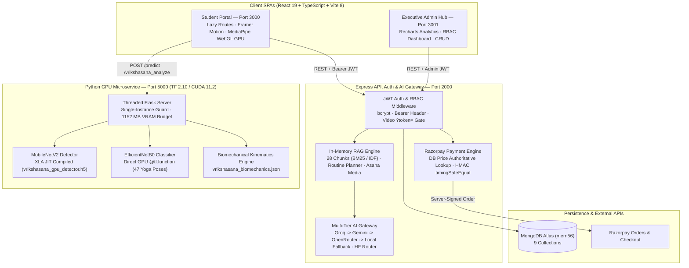

# Yogashrini — AI-Powered Classical Yoga, Biomechanics & Wellness Platform

[](Frontend/package.json)
[](Frontend/vite.config.ts)
[](Backend/index.js)
[](Python%20Backend/app.py)
[](Backend/services/razorpay_service.js)

**Yogashrini** is a full-stack, multi-service movement intelligence and yoga studio platform that unifies classical yogic traditions (Hatha, Vinyasa, Ashtanga, Iyengar) with **GPU-accelerated Computer Vision**, **Retrieval-Augmented Generation (RAG)**, **Metabolic Diet & Routine Planning**, **Encrypted LMS Video Courses**, and **Enterprise Studio Commerce**.

---

## Table of Contents

1. [Platform Features](#1-platform-features)
2. [System Architecture](#2-system-architecture)
3. [Deep Learning, Biomechanics & GPU Optimization](#3-deep-learning-biomechanics--gpu-optimization)
4. [Security, RBAC & Payment Integrity](#4-security-rbac--payment-integrity)
5. [Repository Structure](#5-repository-structure)
6. [Getting Started & Local Setup](#6-getting-started--local-setup)
7. [API Endpoints Reference](#7-api-endpoints-reference)
8. [Documentation & Research Index](#8-documentation--research-index)

---

## 1. Platform Features

### Real-Time Computer Vision & Coaching

- **Live AI Vrikshasana Coach (`/live-trainer`)**:
  - Uses `@mediapipe/tasks-vision` (`PoseLandmarker` on WebGL `GPU` delegate with local WASM and `.task` assets under `Frontend/public/mediapipe/`) decoupled from a smooth `requestAnimationFrame` canvas render loop using Exponential Moving Average (EMA) joint smoothing.
  - Supports a live **`60 FPS Turbo` (`pose_landmarker_lite.task`) / `High Accuracy` (`pose_landmarker_full.task`)** mode toggle, real-time FPS & latency HUD pills, and non-blocking verification against the Flask RTX 3050 CNN backend.
  - Evaluates a **100-point Vrikshasana biomechanical rubric** (Standing Leg `25`, Bent Leg & Abduction `30`, Foot Placement `15`, Arms & Prayer Mudra `20`, Spine Tilt `10`), fires an instant **knee lateral-pressure danger alert** if the lifted foot rests on the standing knee joint, and speaks corrective instructions via **Web Speech API** + Web Audio feedback tones.
- **47-Class Photo Posture Identifier (`/posture`)**:
  - Classifies uploaded yoga photographs across **47 canonical Sanskrit yoga poses** using a fine-tuned **EfficientNetB0** classifier (`POST /predict`), returning Top-1 prediction, calibrated confidence percentage, Top-5 breakdown, and a diagnostic annotated image.
- **Classical Asana Compendium (`/types`)**:
  - Searchable directory of 47+ postures filterable by English or Sanskrit nomenclature with theme-adaptive SVG artwork.

### Personalized AI Wellness, Diet & RAG Assistant

- **Weight & Height Daily Routine Tracker with Printable PDF (`/`)**:
  - Implemented in [`Frontend/src/components/DailyRoutineTracker.tsx`](Frontend/src/components/DailyRoutineTracker.tsx), [`Frontend/src/utils/routinePdf.ts`](Frontend/src/utils/routinePdf.ts), and [`Backend/services/routine_planner_service.js`](Backend/services/routine_planner_service.js).
  - Calculates BMI, BMR, and TDEE from practitioner inputs (weight, height, age, biological sex, activity level, diet preference, and **Weight Loss / Weight Gain / Maintenance** goal), grounded in the **28-chunk Metabolic Diet & Yoga RAG corpus** ([`docs/rag/YOGA_METABOLIC_DIET_AND_ASANA_RAG.md`](docs/rag/YOGA_METABOLIC_DIET_AND_ASANA_RAG.md)).
  - Prescribes time-slotted meals, macronutrient targets, AM/PM/Pranayama yoga sequences paired with resolved asana illustrations, and exports a clean, multi-section **Download / Print PDF** via `jsPDF`.
- **Grounded RAG Chatbot with Asana Images & Hugging Face Fallback (`Chatbot`)**:
  - Floating assistant available across every route backed by an in-memory IDF/BM25 inverted index (`28` indexed chunks across Yoga Philosophy, Biomechanics, Pranayama, and Metabolic Nutrition) and a 4-tier LLM failover chain (**Groq -> Google Gemini -> OpenRouter -> Local Deterministic Engine**).
  - Automatically attaches structured **Asana Reference Cards** resolved via [`Backend/services/asana_media_service.js`](Backend/services/asana_media_service.js), or synthesizes custom visual cards on demand via [`Backend/services/hf_image_service.js`](Backend/services/hf_image_service.js) (Hugging Face router when `HUGGINGFACE_API_KEY` is configured, with automatic vector SVG cache fallback).
- **Practice Sequence Synthesizer, Orthopedic Contraindication Scanner & 30-Day Clinical Report (`/`)**:
  - Generates time-boxed custom sequences (duration, anatomical focus, energy level), screens injuries (*lower back*, *knee*, *carpal tunnel*, *neck*, *hypertension*) with Iyengar prop modifications, and compiles structured 30-day wellness plans.

### Learning Management, Studio Commerce & Executive Admin

- **Multi-Week Video Courses & Persistent "My Courses" (`/courses`, `/course/:id`, `/course/:id/week/:weekNum`)**:
  - Includes an account-scoped **"My Courses"** section fed directly from authenticated MongoDB enrollments (`GET /user/me` / `/course`), tracking week completion checkpoints and XP progress per logged-in user.
  - Enforces a server-side enrollment paywall that strips lesson video filenames (`authorized: false`) for unpaid callers and requires a valid `?token=<jwt>` query token for `/videos/*` static media playback.
- **Tamper-Proof Wellness Store, Retreats & Schedule (`/training`, `/retreat`, `/classes`)**:
  - Unified Razorpay online checkout alongside Studio Pickup / COD support across Course Enrollments, Store Prop Orders (with server-side inventory validation & deduction), and Retreat Bookings.
- **Executive Admin Decision Hub (`Admin/`, Port `3001`)**:
  - Protected by role-based JWT verification (`requireAdmin`), featuring Recharts revenue & cohort analytics, AI-generated Executive Strategy Briefings (`GET /ai/admin-executive-briefing`), multi-week video uploaders, inventory controls, and order/retreat fulfillment dashboards.

---

## 2. System Architecture

Yogashrini separates real-time video/CNN compute from commerce, authentication, and RAG orchestration across four cooperative services:



---

## 3. Deep Learning, Biomechanics & GPU Optimization

Designed specifically to run smoothly alongside browser WebGL on a **4 GB NVIDIA GeForce RTX 3050 Laptop GPU** without VRAM exhaustion:

| Model / Engine | Backbone & Input | Role | Verified Performance Metrics |
| :--- | :--- | :--- | :--- |
| **47-Class Asana Classifier** | `EfficientNetB0` + GAP + Dense(512) + BN + Dropout(0.5) (`224x224x3`) | Photo posture classification (`POST /predict`) | **95.38%** Test Top-1 · **99.27%** Top-3 · **99.73%** Top-5 · `0.1584` Val Loss · Calibrated `84.96%` `/health` API baseline |
| **Vrikshasana Binary Detector** | `MobileNetV2` (`2.62M` params, upper layers 100–154 fine-tuned) (`224x224x3`) | Real-time binary Tree Pose confidence (`POST /vrikshasana_analyze`) | **90.85%** Precision · **64.50%** Conservative Recall · **75.44%** F1 · `0.7046` ROC-AUC |
| **Biomechanical Kinematics** | MediaPipe 33-Keypoint Vector Calculus | Joint angle (`arccos`), spine tilt (`atan2`), knee safety check | 100-point alignment scoring fused (`0.85x` penalty if CNN probability `< 0.40`) |

### Observed RTX 3050 Optimization Gains

- **Eliminated `.predict()` & Cold-Start Stalls**: Replaced per-frame `model.predict()` (`242.00 ms`, `4.1 FPS`, plus `14,305 ms` first-frame stall) with compiled `@tf.function` XLA (`cuda_nvcc`) and startup GPU warmup passes (`12.46 ms` / `80.3 FPS` isolated kernel; `26.61 ms` server warmup at boot).
- **4 GB VRAM Co-Existence Budgeting**: Added a pre-TensorFlow TCP port `5000` duplicate-process guard and capped TensorFlow GPU allocation at `1152 MB`, preserving `~1948 MB` free VRAM out of `4096 MB` for Windows + Chrome WebGL MediaPipe GPU tracking.
- **Zero-Copy Frontend Pipeline**: Upgraded `@mediapipe/pose` (`window.Camera`) to local GPU-accelerated `@mediapipe/tasks-vision` `PoseLandmarker` (`lite`/`full`), removed per-joint `ctx.shadowBlur` CPU filters, added EMA joint smoothing (`requestAnimationFrame`), and throttled React UI state commits (~9 Hz).

---

## 4. Security, RBAC & Payment Integrity

- **Zero Client-Trusted Pricing**: `createOrder` / checkout endpoints compute totals strictly from MongoDB records (`course.price`, `product.pprice * quantity`, `retreat.rcost * guests`) in integer paise and persist server-bound order records.
- **Anti-Course-Swap & Constant-Time HMAC**: Payment verification queries strictly by `{ userId, itemId, orderId }` and compares Razorpay signatures via `crypto.timingSafeEqual`.
- **Role-Based Access Control (RBAC)**:
  - Admin endpoints enforce `authenticate` + `requireAdmin` (`403 Forbidden` for user tokens).
  - `/videos/*` requires JWT authorization (`Authorization` header or `?token=`).
  - Frontend clients inject auth headers centrally (`Frontend/src/utils/api.ts`, `Admin/src/utils/api.ts`) and emit `yoga:auth-expired` on `401`.
- **Secret Hygiene**: `.env` files, zip archives, datasets, and large weights are excluded from Git tracking via `.gitignore`; environment configuration uses documented `.env.example` templates.

---

## 5. Repository Structure

```text
yogashrini/
├── Frontend/                         # Student Web Portal (React 19, TypeScript, Vite 8 — Port 3000)
│   ├── public/mediapipe/             # Local WebGL WASM runtime & .task pose landmarker models
│   └── src/
│       ├── components/               # DailyRoutineTracker.tsx, MarkdownView.tsx, PageLoader.tsx
│       ├── inc/                      # Navbar.tsx (Portal drawer), Chatbot.tsx
│       ├── pages/                    # 14 lazy-loaded pages (LiveTrainer, Posture, Courses, Dashboard...)
│       ├── utils/                    # api.ts (authFetch, GPU MediaPipe, Razorpay), routinePdf.ts
│       ├── AuthContext.tsx
│       └── App.tsx
│
├── Admin/                            # Executive Admin Portal (React 19, Recharts 3, Vite 8 — Port 3001)
│   └── src/
│       ├── inc/                      # Sidebar.tsx, Top.tsx
│       ├── pages/                    # Dashboard, Course/Product/Retreat CRUD & Video Manager
│       └── utils/api.ts              # Centralized adminFetch JWT client
│
├── Backend/                          # Express API, Auth, Razorpay & RAG Gateway (Node.js — Port 2000)
│   ├── config/index.js               # Environment validation & security defaults
│   ├── controller/                   # admin, ai, course, payment, product, retreat, user controllers
│   ├── data/                         # yoga_knowledge_base.json, poses_catalog.json
│   ├── db/                           # 9 Mongoose models & schemas
│   ├── middleware/auth.js            # JWT authenticate, optionalAuth, requireAdmin
│   ├── public/                       # Static assets (pose_cache SVGs, product_img, thumbnails)
│   ├── routes/                       # Domain REST routers & /ai endpoints
│   ├── services/                     # ai_gateway, rag_service, razorpay_service, routine_planner, asana_media, hf_image
│   ├── .env.example
│   └── index.js
│
├── Python Backend/                   # Flask GPU Deep Learning Service (Python 3.10 — Port 5000)
│   ├── app.py                        # EfficientNetB0 (47 classes), Vrikshasana XLA Detector, Biomechanics
│   └── run_backend.bat
│
├── docs/                             # Technical Feature Manuals & Metabolic Diet RAG Corpus
│   ├── features/                     # 01–07 architecture specs & README_all.md
│   └── rag/YOGA_METABOLIC_DIET_AND_ASANA_RAG.md
│
├── CONTEXT_README.md                 # Master platform context & 17-slide PPT blueprint
├── *.ipynb / *.py                    # Training notebooks, EDA scripts & evaluation pipelines
└── run_all.bat / stop_all.bat        # Windows multi-service launcher & shutdown utilities
```

*(Note: When running inside local dual-folder setups where Express lives under `Server/` and Admin under `admin/`, `run_all.bat` automatically detects both `Backend/`|`Server/` and `Admin/`|`admin/`.)*

---

## 6. Getting Started & Local Setup

### Prerequisites

- **Node.js** `18+` (LTS recommended) and `npm`
- **MongoDB Atlas** cluster URI (or local MongoDB instance)
- **Python 3.10** (`tensorflow==2.10.0`, `keras==2.10.0`, `numpy<2`, `flask`, `flask-cors`, `pillow`, `opencv-python`) with **CUDA 11.2 / cuDNN 8.1** for NVIDIA GPU acceleration (or CPU fallback)
- Local `saved_models/` weights (`efficientnetb0_yoga.weights.h5`, `vrikshasana_gpu_detector.h5`, `class_names.json`, `vrikshasana_biomechanics.json`) and `Dataset_Vrikshasana_CV/reference_pose.jpg` *(excluded from Git due to binary/dataset size)*

### Step 1: Configure Backend Environment Variables

Copy `Backend/.env.example` to `Backend/.env` and fill in your credentials:

```cmd
copy Backend\.env.example Backend\.env
```

| Variable | Required | Description |
| :--- | :--- | :--- |
| `PORT` | Yes | Express server port (`2000`) |
| `MONGO_URI` | Yes | MongoDB Atlas / local connection string |
| `JWT_SECRET` | Yes | High-entropy secret for HS256 JWT signing |
| `ADMIN_EMAIL` / `ADMIN_PASSWORD` | Initial Seed | Credentials used when seeding via `/admin/add` |
| `RAZORPAY_KEY_ID` / `RAZORPAY_KEY_SECRET` | For Checkout | Razorpay test/live API credentials |
| `GROQ_API_KEY`, `GEMINI_API_KEY`, `OPENROUTER_API_KEY` | Optional (LLM) | Cloud LLM keys for RAG generation (falls back locally if omitted) |
| `HUGGINGFACE_API_KEY` | Optional (Images) | Enables live AI asana illustration synthesis via Hugging Face router |

### Step 2: Install Node Dependencies

```cmd
cd Backend && npm install
cd ..\Admin && npm install
cd ..\Frontend && npm install --legacy-peer-deps
```

*(Note: `--legacy-peer-deps` resolves legacy `react-scripts` peer constraint alongside TypeScript 7 + Vite 8 in `Frontend/`.)*

### Step 3: Launch Services

- **All-in-One (Windows)**: Run [`run_all.bat`](run_all.bat) from the repository root.
- **Manual Startup**:
  1. **Express Gateway**: `cd Backend && npm start` (`http://localhost:2000`)
  2. **Python GPU Vision**: `cd "Python Backend" && python -u app.py` (`http://localhost:5000`)
  3. **Student SPA**: `cd Frontend && npm run dev` (`http://localhost:3000`)
  4. **Admin Hub**: `cd Admin && npm run dev` (`http://localhost:3001`)

---

## 7. API Endpoints Reference

### Express Backend (`http://localhost:2000`)

| Group | Method & Path | Access | Purpose |
| :--- | :--- | :--- | :--- |
| **Health** | `GET /health` | Public | Server uptime, memory, and MongoDB connection state |
| **Auth** | `POST /user/signup`, `POST /user/login`, `GET /user/me` | Public / JWT | Registration, login, and account profile + active courses |
| **AI & RAG** | `POST /chat`, `POST /ai/chat` | Public | Grounded RAG yoga Q&A with attached asana visuals |
| **Planner & Safety** | `POST /ai/daily-routine-tracker`, `POST /ai/generate-routine`, `POST /ai/contraindication-check`, `POST /ai/generate-report` | Public | Weight/height metabolic diet + routine planner, contraindications & 30-day wellness PDF/report |
| **Asana Media** | `GET\|POST /ai/asana-image` | Public | Resolves cached/catalog SVG cards or Hugging Face image generation |
| **Courses** | `GET /course`, `GET /course/:id/weeks`, `POST /course/complete-week` | Optional / JWT | Public course catalog, paywalled lesson syllabus, and week completion tracking |
| **Payments** | `POST /payment/create-order`, `POST /payment/verify`, `POST /product/create-payment-order`, `POST /retreat/create-payment-order` | JWT | Server-priced Razorpay order creation & HMAC-SHA256 verification |
| **Admin** | `GET /admin/analytics`, `GET /ai/admin-executive-briefing`, `POST\|PUT\|DELETE /course\|/product\|/retreat` | Admin JWT | Revenue analytics, AI executive briefings, content & inventory management |

### Python Flask GPU Service (`http://localhost:5000`)

| Endpoint | Method | Purpose |
| :--- | :--- | :--- |
| `/health` | `GET` | `EfficientNetB0` status, execution provider, warmup latency & VRAM info |
| `/classes` | `GET` | Returns the 47 yoga class labels (`class_names.json`) |
| `/predict` | `POST` | Classifies base64 photo against 47 poses + returns annotated image & GPU ms |
| `/vrikshasana_status` | `GET` | Real-time RTX 3050 XLA GPU availability, free VRAM & reference status |
| `/vrikshasana_reference` | `GET` | Returns base64 reference image for Tree Pose overlay |
| `/vrikshasana_analyze` | `POST` | Combines 33 MediaPipe landmarks + RTX 3050 CNN confidence + inference telemetry |

---

## 8. Documentation & Research Index

- [`CONTEXT_README.md`](CONTEXT_README.md) — Plain-language platform walkthrough, system & ML design diagrams, and **17-slide presentation blueprint**.
- [`docs/features/README_all.md`](docs/features/README_all.md) — Complete engineering breakdown for modules `01` through `07`.
- [`docs/rag/YOGA_METABOLIC_DIET_AND_ASANA_RAG.md`](docs/rag/YOGA_METABOLIC_DIET_AND_ASANA_RAG.md) — Research corpus governing metabolic calculations, vegetarian/Indian-balanced nutrition rules, and therapeutic asana selection.
