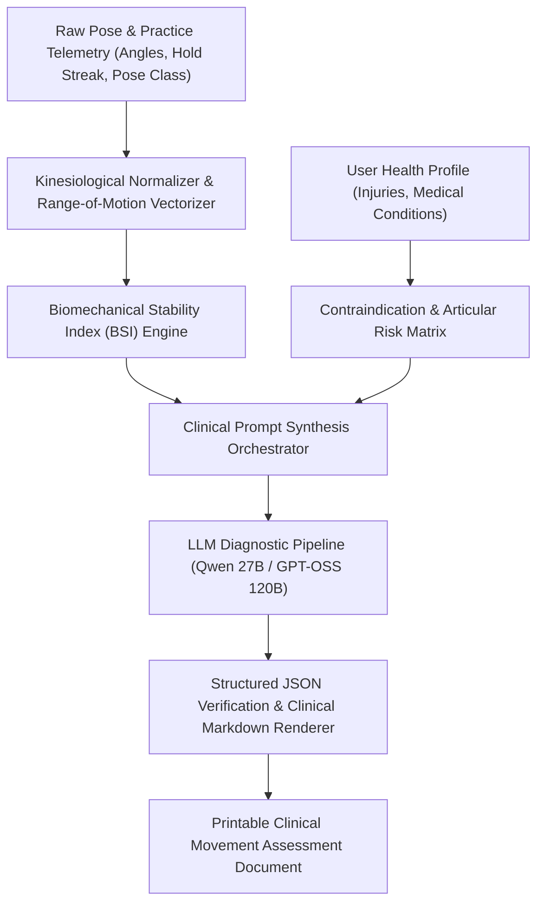

# Feature 02: Multi-Tier Clinical Movement Assessment and Report Generator

## Section 1: Academic and Theoretical Treatise

### 1. Abstract
The Yogashrini Clinical Movement Assessment and Report Generator is a kinesiological diagnostic engine that evaluates human posture telemetry against orthopedic safety baselines. By synthesizing kinetic chain deviations, articular angle tolerances, and user health profiles, the module constructs an executive-grade clinical evaluation comprising stability indices, kinetic chain assessments, contraindication warnings, and prescriptive 30-day corrective regimens.

---

### 2. Theoretical Architecture and Kinesiological Formulations



#### 2.1 Biomechanical Stability Index (BSI)
To evaluate the practitioner's kinetic equilibrium during asana maintenance, the Biomechanical Stability Index $S_{\text{composite}} \in [0, 100]$ is computed as a weighted sum of balance consistency, angular precision, and isometric endurance:

$$S_{\text{composite}} = 100 \times \left( w_b S_{\text{balance}} + w_a \left( 1 - \frac{1}{J} \sum_{j=1}^J \frac{|\theta_j - \theta_j^*|}{\theta_j^{\text{tolerance}}} \right) + w_e \min\left(1, \frac{T_{\text{hold}}}{T_{\text{target}}}\right) \right)$$

Where:
- $w_b = 0.35, w_a = 0.45, w_e = 0.20$ represent empirical clinical weighting coefficients ($\sum w = 1.0$).
- $J$ denotes the set of key articulating joints monitored for the specific asana ($J = \{\text{standing knee}, \text{hip abduction}, \text{spine inclination}\}$).
- $\theta_j$ is the observed angle, $\theta_j^*$ is the canonical anatomical reference angle, and $\theta_j^{\text{tolerance}}$ is the maximum allowable deviation before joint strain occurs.
- $T_{\text{hold}}$ is the continuous isometric hold duration in seconds, and $T_{\text{target}}$ is the prescribed milestone (e.g., 30.0 seconds).

#### 2.2 Kinetic Chain Diagnostics
Human locomotion and isometric posture operate along closed kinetic chains. In Vrikshasana (Tree Pose), lateral pelvic drop indicates weakness in the contralateral gluteus medius:

$$\text{Trendelenburg Sign Metric: } \Delta y_{\text{ASIS}} = |y_{\text{left\_hip}} - y_{\text{right\_hip}}|$$

When $\Delta y_{\text{ASIS}} > \delta_{\text{critical}}$, the system identifies compensatory lumbar lateral flexion and issues a prioritized kinetic chain diagnostic alert.

---

## Section 2: Step-by-Step Implementation Guide for Beginners

### 1. Conceptual Overview: The Athletic Checkup Analogy
When a professional athlete visits a sports doctor, the doctor does not simply say "you did good." Instead, the doctor looks at exact numbers: how straight your leg was, how many seconds you balanced without wobbling, and whether your spine was twisted. Then, the doctor writes a comprehensive report that explains what muscles to strengthen and what exercises to do over the next month.

Our Smart Report Generator works the exact same way:
1. It gathers the numbers from your webcam posture session (alignment score, hold time, poses practiced).
2. It sends those numbers to our AI doctor service.
3. The AI formats a multi-page, printable clinical document complete with scores, warnings, and a 30-day plan.

---

### 2. Step 1: Server-Side Controller Implementation
Create the report generation handler in `Server/controller/ai_controller.js`:

```javascript
// Server/controller/ai_controller.js
const { callGroqChat } = require("../services/ai_gateway");

exports.generateSmartReport = async (req, res) => {
  try {
    const {
      studentName = "Practitioner",
      targetAsana = "Vrikshasana (Tree Pose)",
      alignmentScore = 88,
      holdSeconds = 24,
      jointAngles = { standingKnee: 178, liftedKnee: 44, torsoTilt: 4.2 },
      contraindications = ["Mild lower back stiffness"]
    } = req.body;

    const prompt = `You are the Yogashrini Senior Clinical Biomechanics and Movement Assessment Director.
Generate a formal, publication-grade Clinical Movement Assessment Report for:
- Student: ${studentName}
- Evaluated Pose: ${targetAsana}
- Real-time Alignment Score: ${alignmentScore}%
- Sustained Hold Streak: ${holdSeconds} seconds
- Recorded Joint Angles: ${JSON.stringify(jointAngles)}
- Stated Health Profile: ${contraindications.join(", ")}

Structure your report into the following formal sections:
1. EXECUTIVE CLINICAL OVERVIEW
2. BIOMECHANICAL STABILITY & KINETIC CHAIN DIAGNOSTICS
3. ORTHOPEDIC CONTRAINDICATIONS & SAFETY CLEARANCE
4. 30-DAY PRESCRIPTIVE CORRECTIVE REGIMEN (Weekly breakdown)`;

    const reportContent = await callGroqChat([
      { role: "system", content: "You are an expert orthopedic biomechanist. Do not use any emojis in your response." },
      { role: "user", content: prompt }
    ]);

    res.json({
      success: true,
      data: {
        report: reportContent,
        generatedAt: new Date().toISOString(),
        studentName,
        targetAsana,
        alignmentScore
      }
    });
  } catch (err) {
    res.status(500).json({ success: false, error: err.message });
  }
};
```

---

### 3. Step 2: Route Registration
In `Server/routes/ai_r.js`, bind the endpoint:

```javascript
// Server/routes/ai_r.js
const express = require("express");
const router = express.Router();
const aiController = require("../controller/ai_controller");

router.post("/generate-report", aiController.generateSmartReport);

module.exports = router;
```

---

### 4. Step 3: Frontend Modal and Print Integration
In `Frontend/src/pages/UserDashboard.js`, provide the trigger button and printable assessment modal:

```jsx
import React, { useState } from "react";
import { MdAssessment, MdPrint, MdClose, MdRefresh } from "react-icons/md";

export default function ReportModalTrigger({ stats }) {
  const [report, setReport] = useState(null);
  const [loading, setLoading] = useState(false);
  const [showModal, setShowModal] = useState(false);

  const requestReport = async () => {
    setLoading(true);
    setShowModal(true);
    const res = await fetch("http://localhost:2000/ai/generate-report", {
      method: "POST",
      headers: { "Content-Type": "application/json" },
      body: JSON.stringify({
        studentName: localStorage.getItem("uname") || "Student",
        alignmentScore: stats.alignmentScore || 85,
        holdSeconds: stats.holdSeconds || 20
      })
    });
    const data = await res.json();
    if (data.success) {
      setReport(data.data.report);
    }
    setLoading(false);
  };

  return (
    <>
      <button className="btn btn-primary" onClick={requestReport}>
        <MdAssessment /> Generate Clinical Assessment Report
      </button>

      {showModal && (
        <div className="report-modal-overlay">
          <div className="report-modal-content">
            <div className="report-modal-header">
              <h3>Yogashrini Clinical Movement Assessment</h3>
              <div className="modal-actions">
                <button onClick={() => window.print()}><MdPrint /> Print</button>
                <button onClick={() => setShowModal(false)}><MdClose /></button>
              </div>
            </div>
            <div className="report-modal-body">
              {loading ? (
                <div className="loading-state">Synthesizing Clinical Analysis...</div>
              ) : (
                <pre className="clinical-text">{report}</pre>
              )}
            </div>
          </div>
        </div>
      )}
    </>
  );
}
```

---

## Section 3: API Specification

### Endpoint: Generate Clinical Movement Assessment Report
- **Method**: `POST`
- **Path**: `/ai/generate-report`
- **Headers**: `Content-Type: application/json`

#### Request Payload
```json
{
  "studentName": "Aditi Sharma",
  "targetAsana": "Vrikshasana (Tree Pose)",
  "alignmentScore": 92,
  "holdSeconds": 30,
  "jointAngles": {
    "standingKnee": 180,
    "bentKnee": 48,
    "torsoTilt": 2.4
  },
  "contraindications": [
    "Patellofemoral tracking syndrome",
    "Mild lumbar hyperlordosis"
  ]
}
```

#### Response Payload
```json
{
  "success": true,
  "data": {
    "report": "CLINICAL MOVEMENT ASSESSMENT REPORT\n======================================\nPatient: Aditi Sharma\nEvaluation Asana: Vrikshasana\nComposite Stability Index: 92/100 (Optimal)\n\n1. KINETIC CHAIN DIAGNOSTICS:\n- Ground Reaction Force: Evenly dispersed across tripod of foot.\n- Pelvic Stability: Negligible lateral tilt (2.4 deg).\n\n2. PRESCRIPTIVE 30-DAY REGIMEN:\n- Weeks 1-2: Isometric standing holds with wall contact support.\n- Weeks 3-4: Progressive unassisted holds with closed eyes.",
    "generatedAt": "2026-11-16T21:40:00.000Z",
    "studentName": "Aditi Sharma",
    "alignmentScore": 92
  }
}
```
