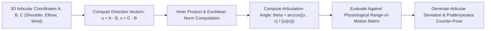

# Feature 03: Real-Time Biomechanical Joint Analysis and Counter-Pose Engine

## Section 1: Academic and Theoretical Treatise

### 1. Abstract
The Yogashrini Biomechanical Joint Analysis and Counter-Pose (Pratikriyasana) Engine performs real-time trigonometric evaluation of musculoskeletal kinematics. By computing joint articulation vectors, detecting compensatory micro-movements, and referencing classical neuromuscular restoration treatises (Hatha Ratnavali, Light on Yoga), the system prescribes precise antagonistic counter-poses to prevent repetitive strain injuries and maintain myofascial equilibrium.

---

### 2. Theoretical Kinematics and Vector Mathematics



#### 2.1 Trigonometric Joint Angle Formulation
Let an articulation joint be defined by vertex keypoint $\mathbf{B} = (x_B, y_B, z_B)$ connecting two adjacent bone segments originating from proximal joint $\mathbf{A} = (x_A, y_A, z_A)$ and distal joint $\mathbf{C} = (x_C, y_C, z_C)$. 

We construct the directed Euclidean vectors $\mathbf{u}$ and $\mathbf{v}$:

$$\mathbf{u} = \mathbf{A} - \mathbf{B} = \begin{bmatrix} x_A - x_B \\ y_A - y_B \\ z_A - z_B \end{bmatrix}, \quad \mathbf{v} = \mathbf{C} - \mathbf{B} = \begin{bmatrix} x_C - x_B \\ y_C - y_B \\ z_C - z_B \end{bmatrix}$$

The interior articular angle $\theta \in [0^\circ, 180^\circ]$ is governed by the inner dot product:

$$\mathbf{u} \cdot \mathbf{v} = \|\mathbf{u}\| \|\mathbf{v}\| \cos \theta$$

Solving for $\theta$:

$$\theta = \arccos\left( \frac{\mathbf{u} \cdot \mathbf{v}}{\|\mathbf{u}\| \|\mathbf{v}\|} \right) = \arccos\left( \frac{u_x v_x + u_y v_y + u_z v_z}{\sqrt{u_x^2 + u_y^2 + u_z^2} \sqrt{v_x^2 + v_y^2 + v_z^2}} \right) \cdot \left(\frac{180^\circ}{\pi}\right)$$

#### 2.2 Principles of Pratikriyasana (Reciprocal Neuromuscular Neutralization)
Every sustained asana introduces directional muscular shortening (concentric contraction) and reciprocal lengthening (eccentric elongation). In Sanskrit biomechanics, **Pratikriyasana** represents the restorative counter-posture designed to restore neutral joint alignment and equalize fascial tension:

$$\Delta \vec{\tau}_{\text{residual}} = \vec{\tau}_{\text{agonist}} + \vec{\tau}_{\text{antagonist}} \to 0$$

- For intense spinal hyperextension (e.g., Urdhva Dhanurasana / Wheel Pose), the engine prescribes mild forward flexion and axial elongation (e.g., Balasana / Child's Pose or Paschimottanasana) to decompress posterior intervertebral disc margins.
- For unilateral hip abduction (e.g., Vrikshasana / Tree Pose), the engine prescribes symmetrical axial grounding (Tadasana / Mountain Pose) followed by bilateral hip adduction.

---

## Section 2: Step-by-Step Implementation Guide for Beginners

### 1. Conceptual Overview: The Human Protractor Analogy
Imagine drawing a stick figure on a sheet of paper. To check if the stick figure is doing a proper lunge or tree pose, you take a transparent plastic protractor, place its center dot on the knee joint, and measure the angle between the thigh and the calf.

If the thigh and calf make a straight line, your protractor reads 180 degrees. If the knee is bent at a sharp right angle, your protractor reads 90 degrees.

Furthermore, if you bend a rubber band backwards for 30 seconds, it stays curled. To return the rubber band to its natural shape, you must gently stretch it in the opposite direction. This is what **Pratikriyasana (Counter-Pose)** means in yoga: safely restoring your muscles to neutral balance!

---

### 2. Step 1: Writing the Angle Calculator Function
In JavaScript, we write a reusable helper that takes three joint points $(A, B, C)$ and returns the exact angle in degrees:

```javascript
// Function to compute angle between 3 landmarks (A = Hip, B = Knee, C = Ankle)
function calculateJointAngle(A, B, C) {
  // Vector BA
  const uX = A.x - B.x;
  const uY = A.y - B.y;
  // Vector BC
  const vX = C.x - B.x;
  const vY = C.y - B.y;

  const dot = uX * vX + uY * vY;
  const magU = Math.sqrt(uX * uX + uY * uY);
  const magV = Math.sqrt(vX * vX + vY * vY);

  if (magU === 0 || magV === 0) return 0;
  
  let cosine = dot / (magU * magV);
  // Clamp between -1 and +1 to avoid floating-point NaN errors
  cosine = Math.max(-1, Math.min(1, cosine));
  
  const radians = Math.acos(cosine);
  return radians * (180 / Math.PI);
}
```

---

### 3. Step 2: Creating the Server-Side Biomechanics Diagnostic Endpoint
In `Server/controller/ai_controller.js`, build `smartBiomechanicsAnalysis`:

```javascript
// Server/controller/ai_controller.js
const { callGroqChat } = require("../services/ai_gateway");
const ragService = require("../services/rag_service");

exports.smartBiomechanicsAnalysis = async (req, res) => {
  try {
    const { poseName = "Vrikshasana", measuredAngles = {} } = req.body;

    // Search canonical target angles from database
    const matches = ragService.search(poseName, 1);
    const reference = matches[0] || {};

    const prompt = `As a kinesiological biomechanics expert, evaluate these joint angles for ${poseName}:
- Measured angles: ${JSON.stringify(measuredAngles)}
- Reference documentation: ${reference.text || "Standard alignment"}

Provide:
1. Deviations exceeding safe physiological tolerances.
2. Kinetic compensation risks (e.g. pelvic tilt, spinal shear).
3. Recommended Pratikriyasana (Counter-pose) and cool-down sequence.`;

    const analysis = await callGroqChat([
      { role: "system", content: "You are a professional kinesiology expert. Do not use emojis." },
      { role: "user", content: prompt }
    ]);

    res.json({
      success: true,
      data: {
        poseName,
        analysis,
        timestamp: new Date().toISOString()
      }
    });
  } catch (err) {
    res.status(500).json({ success: false, error: err.message });
  }
};
```

---

### 4. Step 3: Testing the Endpoint with cURL
Open your command terminal and send test joint telemetry:

```bash
curl -X POST http://localhost:2000/ai/smart-analysis \
  -H "Content-Type: application/json" \
  -d '{
    "poseName": "Vrikshasana",
    "measuredAngles": {
      "standingKnee": 174,
      "liftedKnee": 42,
      "torsoTilt": 7.5
    }
  }'
```

---

## Section 3: API Specification

### Endpoint: Execute Biomechanical Joint Analysis
- **Method**: `POST`
- **Path**: `/ai/smart-analysis`
- **Headers**: `Content-Type: application/json`

#### Request Payload
```json
{
  "poseName": "Virabhadrasana II (Warrior II)",
  "measuredAngles": {
    "frontKneeAngle": 92,
    "backKneeAngle": 178,
    "torsoVerticalAngle": 3.1,
    "shoulderAbductionAngle": 88
  }
}
```

#### Response Payload
```json
{
  "success": true,
  "data": {
    "poseName": "Virabhadrasana II (Warrior II)",
    "analysis": "BIOMECHANICAL EVALUATION:\n1. Front Knee: 92 degrees is optimal. Patella tracks precisely over second toe, preventing medial collateral ligament strain.\n2. Back Knee: 178 degrees maintains active quadriceps engagement without hyperextension.\n\nRECOMMENDED PRATIKRIYASANA (COUNTER-POSE):\n- Tadasana (Mountain Pose) with bilateral grounding for 5 breath cycles.\n- Uttanasana (Standing Forward Fold) with soft knees to decompress the sacroiliac joint and neutralize lumbar erector spinae contraction.",
    "timestamp": "2026-11-16T21:42:00.000Z"
  }
}
```
