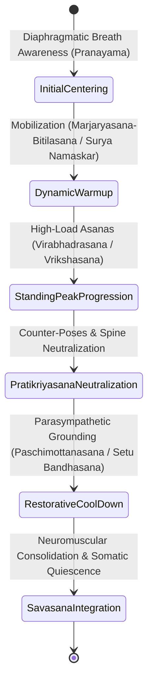

# Feature 05: Adaptive Personalized Practice Sequence Synthesizer

## Section 1: Academic and Theoretical Treatise

### 1. Abstract
The Yogashrini Adaptive Personalized Practice Sequence Synthesizer models dynamic, constraint-satisfaction yoga sequencing based on the classical methodology of *Vinyasa Krama* (intelligent progression). Integrating biometric variables, session duration boundaries, energetic objectives, and autonomic nervous system (ANS) pacing, the system constructs chronologically staged, ergonomically safe routines that maximize somatic benefit while preventing overexertion.

---

### 2. Theoretical Sequencing Mechanics and State Transitions



#### 2.1 The Vinyasa Krama Finite State Transition Formalism
A safe and physiologically cohesive practice routine $R$ of duration $T$ minutes is formulated as an ordered sequence of discrete kinesiological phases $R = \langle \phi_1, \phi_2, \dots, \phi_M \rangle$, subject to the following phase duration constraints:

$$\sum_{m=1}^M \tau(\phi_m) = T, \quad \text{where } \tau(\phi_m) \ge \tau_{\min}(\phi_m)$$

The chronological transitions follow a strict directed graph topology:

1. **Phase 1: Initial Centering ($\phi_{\text{center}}$)** ($\approx 10\% T$): Down-regulates sympathetic adrenergic tone via extended exhalation ratios ($1:2$ *visamavritti pranayama*).
2. **Phase 2: Preparatory Dynamic Warmup ($\phi_{\text{warm}}$)** ($\approx 20\% T$): Synovial fluid secretion across weight-bearing joints (ankles, knees, glenohumeral joints).
3. **Phase 3: Peak Asana Progression ($\phi_{\text{peak}}$)** ($\approx 40\% T$): Demanding isometric and balance postures tailored to the user's focus (e.g., Vrikshasana for balance, Virabhadrasana for lower-limb strength).
4. **Phase 4: Pratikriyasana Neutralization ($\phi_{\text{counter}}$)** ($\approx 15\% T$): Immediate antagonistic muscular relief to prevent post-practice hypertonicity.
5. **Phase 5: Parasympathetic Consolidation ($\phi_{\text{rest}}$)** ($\approx 15\% T$): Final restorative postures concluding in *Savasana* to normalize blood pressure and facilitate motor memory consolidation.

---

## Section 2: Step-by-Step Implementation Guide for Beginners

### 1. Conceptual Overview: The "Workout Music Playlist" Analogy
Imagine making a playlist for a high-energy dance party. You would never start with the loudest, fastest song right when people walk in the door; they need a minute to get warmed up. Similarly, you wouldn't abruptly stop the music in the middle of a sprint and send everyone home; you gradually slow down the tempo so everyone cools off safely.

In yoga, an AI Routine Synthesizer acts just like an expert DJ:
1. **Warm-Up**: Gentle breathing and stretching to get the body ready.
2. **Peak Poses**: The core challenge (standing on one leg, building core strength).
3. **Cool-Down**: Restoring the muscles and relaxing in Savasana.

---

### 2. Step 1: Server-Side Routine Generator
In `Server/controller/ai_controller.js`, implement `generateRoutine`:

```javascript
// Server/controller/ai_controller.js
const { callGroqChat } = require("../services/ai_gateway");

exports.generateRoutine = async (req, res) => {
  try {
    const {
      durationMinutes = 20,
      focusArea = "Balance & Core Stability",
      experienceLevel = "Beginner",
      energyLevel = "Moderate"
    } = req.body;

    const prompt = `Synthesize a structured Vinyasa Krama yoga routine for:
- Duration: ${durationMinutes} minutes
- Focus: ${focusArea}
- Level: ${experienceLevel}
- Energy: ${energyLevel}

Format as clear chronological stages:
1. Centering & Breathwork (Pranayama)
2. Warm-Up & Joint Mobilization
3. Standing & Peak Asanas
4. Counter-Poses & Core Integration
5. Restorative Cool-down & Savasana

Include exact minute allocations for each stage. Do not use emojis.`;

    const routine = await callGroqChat([
      { role: "system", content: "You are an expert yoga sequence designer. Use zero emojis." },
      { role: "user", content: prompt }
    ]);

    res.json({
      success: true,
      data: {
        routine,
        parameters: { durationMinutes, focusArea, experienceLevel, energyLevel },
        generatedAt: new Date().toISOString()
      }
    });
  } catch (err) {
    res.status(500).json({ success: false, error: err.message });
  }
};
```

---

### 3. Step 2: Creating the Interactive Routine Generator Component
In `Frontend/src/pages/UserDashboard.js`, mount the routine generator card:

```jsx
import React, { useState } from "react";
import { MdFitnessCenter, MdPlayArrow } from "react-icons/md";

export default function RoutineGenerator() {
  const [duration, setDuration] = useState(20);
  const [focus, setFocus] = useState("Balance & Equilibrium");
  const [routine, setRoutine] = useState("");
  const [loading, setLoading] = useState(false);

  const handleGenerate = async () => {
    setLoading(true);
    const res = await fetch("http://localhost:2000/ai/generate-routine", {
      method: "POST",
      headers: { "Content-Type": "application/json" },
      body: JSON.stringify({ durationMinutes: duration, focusArea: focus })
    });
    const data = await res.json();
    if (data.success) {
      setRoutine(data.data.routine);
    }
    setLoading(false);
  };

  return (
    <div className="routine-card">
      <h3><MdFitnessCenter /> Personalized Routine Synthesizer</h3>
      <div className="input-group">
        <label>Session Duration (Minutes):</label>
        <select value={duration} onChange={e => setDuration(Number(e.target.value))}>
          <option value={15}>15 Minutes (Express)</option>
          <option value={20}>20 Minutes (Standard)</option>
          <option value={30}>30 Minutes (Deep Dive)</option>
          <option value={45}>45 Minutes (Full Mastery)</option>
        </select>
      </div>
      <button onClick={handleGenerate} disabled={loading}>
        <MdPlayArrow /> {loading ? "Synthesizing Sequence..." : "Generate Practice Routine"}
      </button>

      {routine && (
        <div className="routine-result">
          <pre>{routine}</pre>
        </div>
      )}
    </div>
  );
}
```

---

## Section 3: API Specification

### Endpoint: Synthesize Personalized Practice Sequence
- **Method**: `POST`
- **Path**: `/ai/generate-routine`
- **Headers**: `Content-Type: application/json`

#### Request Payload
```json
{
  "durationMinutes": 25,
  "focusArea": "Hip Mobility & Hamstring Flexibility",
  "experienceLevel": "Intermediate",
  "energyLevel": "Dynamic"
}
```

#### Response Payload
```json
{
  "success": true,
  "data": {
    "routine": "25-MINUTE PERSONALIZED PRACTICE SEQUENCE\n=========================================\nFocus: Hip Mobility & Hamstring Flexibility\n\nSTAGE 1: CENTERING & PRANAYAMA (3 Minutes)\n- Sukhasana with Nadi Shodhana (Alternate Nostril Breathing).\n\nSTAGE 2: WARM-UP & MOBILITY (5 Minutes)\n- Marjaryasana-Bitilasana (Cat-Cow) with circular pelvic spirals.\n- Adho Mukha Svanasana (Downward Dog) with alternate heel pedaling.\n\nSTAGE 3: PEAK ASANAS (10 Minutes)\n- Anjaneyasana (Low Lunge) with hip flexor opening - 5 breaths per side.\n- Virabhadrasana II (Warrior II) into Utthita Parsvakonasana.\n- Vrikshasana (Tree Pose) focusing on external femoral rotation.\n\nSTAGE 4: PRATIKRIYASANA & COUNTER-POSES (4 Minutes)\n- Balasana (Child's Pose) with arms extended.\n- Setu Bandhasana (Bridge Pose) to neutralize lumbar curvature.\n\nSTAGE 5: SAVASANA INTEGRATION (3 Minutes)\n- Full supine resting with complete neuromuscular release.",
    "parameters": {
      "durationMinutes": 25,
      "focusArea": "Hip Mobility & Hamstring Flexibility",
      "experienceLevel": "Intermediate",
      "energyLevel": "Dynamic"
    },
    "generatedAt": "2026-11-16T21:44:00.000Z"
  }
}
```
