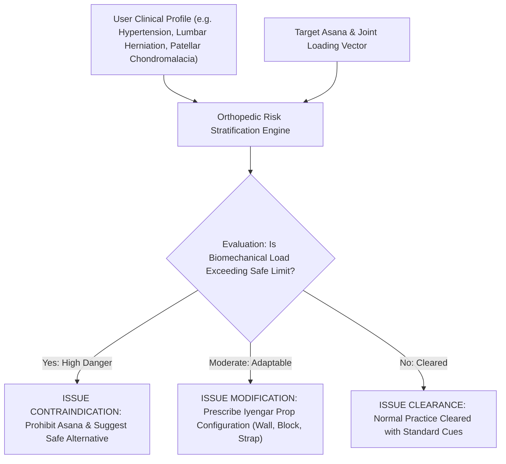

# Feature 06: Clinical Contraindication and Prop Modification Auditor

## Section 1: Academic and Theoretical Treatise

### 1. Abstract
The Yogashrini Clinical Contraindication and Prop Modification Auditor is an orthopedic safety engine that protects yoga practitioners by auditing intended asana routines against known medical conditions, musculoskeletal injuries, and physiological contraindications. Utilizing a bi-directional mapping between biomechanical stress vectors (lumbar shear, intraocular hydrostatic pressure, cervical axial loading) and therapeutic prop adaptations, the auditor renders real-time safety clearances and certified modifications.

---

### 2. Theoretical Mechanics and Orthopedic Risk Stratification



#### 2.1 Biomechanical Stress Vectors and Pathological Conflicts
Certain classical asanas generate concentrated stress vectors that directly conflict with underlying clinical pathologies:

1. **Cervical Axial Compression Vector ($\vec{F}_{\text{cervical}}$)**:
   In *Salamba Sirsasana* (Headstand), the cervical vertebrae C1-C7 experience direct axial gravitational loads exceeding $40\%$ of body weight. For individuals with cervical disc degeneration or osteoporosis:

   $$\sigma_{\text{cervical}} = \frac{F_{\text{axial}}}{A_{\text{vertebra}}} > \sigma_{\text{failure\_threshold}}$$

   The auditor classifies this as **CRITICAL HAZARD** and substitutes *Viparita Karani* (Legs-Up-The-Wall Pose) with bolster support.

2. **Intraocular Pressure ($\Delta P_{\text{IOP}}$)**:
   Full inversions double intraocular fluid pressure from baseline $15 \text{ mmHg}$ to $> 32 \text{ mmHg}$, posing severe risks of optic nerve damage in glaucoma and uncontrolled arterial hypertension patients.

3. **Lumbar Shear Vector ($\vec{F}_{\text{shear}}$)**:
   Deep forward flexion (*Uttanasana*, *Paschimottanasana*) without knee flexion subjects lumbar discs (L4-L5, L5-S1) to anterior shear forces capable of exacerbating posterolateral disc herniations.

#### 2.2 Prop Substitution Mapping
When an asana is therapeutically beneficial but hazardous in its unassisted classical form, the engine applies the **Iyengar Prop Substitution Matrix**:

$$\mathcal{M}(\text{Asana}, \text{Injury}) = (\text{Prop}, \text{Orientation}, \text{Kinematic Adaptation})$$

- In *Vrikshasana* with patellofemoral tracking syndrome: The foot is prohibited from resting against the lateral knee; the modification prescribes placing the heel against the lower calf or using an ankle wall-brace.

---

## Section 2: Step-by-Step Implementation Guide for Beginners

### 1. Conceptual Overview: The "Airport Security Scanner" Analogy
Imagine arriving at the airport with a bag. The security scanner looks inside to ensure there is nothing dangerous before you board the airplane.

Our Safety Scanner does the exact same thing for yoga! If a student has an ankle sprain, a bad knee, or a sore lower back, the AI scanner checks the poses they want to do. If a pose could hurt their knee or strain their back, the scanner immediately raises a warning flag and explains:
*"Do not do the full pose today. Instead, place a yoga block under your hand or stand next to a wall for support."*

---

### 2. Step 1: Server-Side Safety Auditor Endpoint
In `Server/controller/ai_controller.js`, implement `checkContraindications`:

```javascript
// Server/controller/ai_controller.js
const { callGroqChat } = require("../services/ai_gateway");
const ragService = require("../services/rag_service");

exports.checkContraindications = async (req, res) => {
  try {
    const {
      poseName = "Vrikshasana",
      conditions = ["Knee instability", "Lower back tightness"]
    } = req.body;

    // Retrieve verified anatomical data
    const matches = ragService.search(poseName, 1);
    const doc = matches[0] || {};

    const prompt = `You are a clinical yoga therapist and orthopedic safety auditor.
Evaluate the safety of ${poseName} for a practitioner with:
- Stated Conditions: ${conditions.join(", ")}
- Documented Asana Profile: ${doc.text || "Standard alignment"}

Provide:
1. Safety Clearance Status (CLEARED, CAUTION / MODIFIED, or STRICTLY CONTRAINDICATED).
2. Pathological Risk Explanation (which joints or tissues are vulnerable).
3. Iyengar Prop Modifications (blocks, wall support, straps, or gentle variations).
Do not use emojis.`;

    const audit = await callGroqChat([
      { role: "system", content: "You are a clinical movement safety expert. Zero emojis allowed." },
      { role: "user", content: prompt }
    ]);

    res.json({
      success: true,
      data: {
        poseName,
        conditions,
        safetyAudit: audit,
        evaluatedAt: new Date().toISOString()
      }
    });
  } catch (err) {
    res.status(500).json({ success: false, error: err.message });
  }
};
```

---

### 3. Step 2: Creating the Safety Scanner UI Card
In `Frontend/src/pages/UserDashboard.js`, mount the safety scanner:

```jsx
import React, { useState } from "react";
import { MdHealthAndSafety, MdShield } from "react-icons/md";

export default function SafetyScanner() {
  const [pose, setPose] = useState("Vrikshasana");
  const [condition, setCondition] = useState("Knee meniscus repair");
  const [result, setResult] = useState("");
  const [loading, setLoading] = useState(false);

  const runAudit = async () => {
    setLoading(true);
    const res = await fetch("http://localhost:2000/ai/contraindication-check", {
      method: "POST",
      headers: { "Content-Type": "application/json" },
      body: JSON.stringify({ poseName: pose, conditions: [condition] })
    });
    const data = await res.json();
    if (data.success) {
      setResult(data.data.safetyAudit);
    }
    setLoading(false);
  };

  return (
    <div className="safety-scanner-card">
      <h3><MdHealthAndSafety /> Clinical Contraindication Scanner</h3>
      <div className="form-group">
        <label>Select Target Pose:</label>
        <input value={pose} onChange={e => setPose(e.target.value)} />
      </div>
      <div className="form-group">
        <label>Medical Condition or Injury:</label>
        <input value={condition} onChange={e => setCondition(e.target.value)} />
      </div>
      <button onClick={runAudit} disabled={loading}>
        <MdShield /> {loading ? "Auditing Safety..." : "Run Safety Audit"}
      </button>

      {result && (
        <div className="audit-output">
          <pre>{result}</pre>
        </div>
      )}
    </div>
  );
}
```

---

## Section 3: API Specification

### Endpoint: Audit Pose Contraindications
- **Method**: `POST`
- **Path**: `/ai/contraindication-check`
- **Headers**: `Content-Type: application/json`

#### Request Payload
```json
{
  "poseName": "Sirsasana (Headstand)",
  "conditions": [
    "Hypertension (High Blood Pressure)",
    "Cervical spine disc bulge at C5-C6"
  ]
}
```

#### Response Payload
```json
{
  "success": true,
  "data": {
    "poseName": "Sirsasana (Headstand)",
    "conditions": [
      "Hypertension (High Blood Pressure)",
      "Cervical spine disc bulge at C5-C6"
    ],
    "safetyAudit": "SAFETY CLEARANCE STATUS: STRICTLY CONTRAINDICATED\n\n1. PATHOLOGICAL RISK:\n- Sirsasana channels substantial body mass through the cervical spine, creating axial compressive shear that can herniate compromised discs at C5-C6.\n- Full inversion doubles intraocular and cerebral arterial pressure, presenting severe cardiovascular risk in hypertensive patients.\n\n2. THERAPEUTIC PROP SUBSTITUTION:\n- Substitute with Viparita Karani (Legs-Up-The-Wall Pose) supported by a firm bolster under the sacrum.\n- Keeps the head and heart level, relieving cervical loading while providing restorative circulation benefits safely.",
    "evaluatedAt": "2026-11-16T21:46:00.000Z"
  }
}
```
