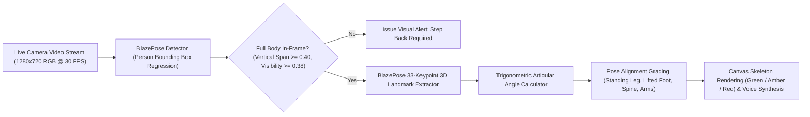

# Feature 07: Real-Time MediaPipe Skeleton Tracker and GPU Posture Aligner

## Section 1: Academic and Theoretical Treatise

### 1. Abstract
The Yogashrini Real-Time Pose Coaching Pipeline combines edge-accelerated computer vision (Google MediaPipe BlazePose) with GPU-backed deep neural networks (TensorFlow 2.10 running on NVIDIA RTX GPUs via CUDA/cuDNN). Operating at 30+ frames per second directly in the browser runtime, the engine extracts 33 three-dimensional skeletal coordinates, evaluates spatial and angular biomechanical constraints in real time, and synthesizes instantaneous corrective feedback via visual overlays and low-latency speech synthesis.

---

### 2. Deep Learning Topology and Mathematical Formulations



#### 2.1 BlazePose 3D Landmark Coordinate Space
The detector regresses 33 topological keypoints $\mathbf{P}_i = (x_i, y_i, z_i, v_i)$ for $i \in \{0, 1, \dots, 32\}$, where:
- $(x_i, y_i) \in [0.0, 1.0]^2$ represent normalized image raster coordinates.
- $z_i$ represents relative depth scaled roughly to the torso dimension.
- $v_i \in [0.0, 1.0]$ represents landmark visibility confidence.

#### 2.2 Bounding Envelope and Full-Body Visibility Condition
To avoid false-positive alignment scoring caused by partial torso occlusions, the pipeline enforces a strict full-body presence constraint over critical anatomical nodes $\mathcal{J}_{\text{critical}} = \{\text{nose}, \text{left/right shoulder}, \text{left/right hip}, \text{left/right knee}, \text{left/right ankle}\}$:

$$\text{FullBodyDetected} = \left( |y_{\text{ankle}} - y_{\text{nose}}| \ge 0.40 \right) \bigwedge \left( \forall j \in \mathcal{J}_{\text{critical}}: v_j \ge 0.38 \wedge 0.02 \le x_j, y_j \le 0.98 \right)$$

If this condition evaluates to false, scoring is halted and the canvas illuminates an amber bounding perimeter indicating the practitioner must step back.

#### 2.3 Biacromial Diameter Normalization for Anjali Mudra (Prayer Posture)
Evaluating hand positioning (Anjali Mudra at the heart or overhead) must remain scale-invariant regardless of the practitioner's camera distance. The system computes the biacromial diameter (shoulder width) as the normalizer:

$$W_{\text{shoulder}} = |x_{\text{left\_shoulder}} - x_{\text{right\_shoulder}}| + \epsilon$$

The inter-wrist Euclidean distance $D_{\text{wrist}} = \sqrt{(x_{\text{lw}} - x_{\text{rw}})^2 + (y_{\text{lw}} - y_{\text{rw}})^2}$ is normalized:

$$\rho_{\text{wrist}} = \frac{D_{\text{wrist}}}{W_{\text{shoulder}}}$$

Palms are registered as joined in true prayer mudra when:

$$\rho_{\text{wrist}} < 0.35 \quad \text{and} \quad (y_{\text{lw}} < y_{\text{ls}} - 0.06) \wedge (y_{\text{rw}} < y_{\text{rs}} - 0.06) \quad \text{[Overhead]}$$

$$\rho_{\text{wrist}} < 0.25 \quad \text{and} \quad (y_{\text{ls}} \le y_{\text{lw}} \le y_{\text{lh}}) \wedge (y_{\text{rs}} \le y_{\text{rw}} \le y_{\text{rh}}) \quad \text{[Heart Center]}$$

---

## Section 2: Step-by-Step Implementation Guide for Beginners

### 1. Conceptual Overview: The "Magic Video Game Mirror" Analogy
Have you ever played a video game where a camera tracks your movements and turns you into a virtual superhero? That is how our AI Posture Coach works.

1. The camera sees you standing in front of your computer.
2. The AI draws 33 invisible dots on your joints (head, shoulders, elbows, wrists, hips, knees, and ankles).
3. It connects the dots with bright lines, creating a glowing stick figure.
4. If your leg is straight, the line turns bright neon green.
5. If your foot is slipping or resting on your knee joint (which could cause injury), the line turns red and the computer actually speaks out loud: *"Move your foot off your knee joint!"*

---

### 2. Step 1: Loading MediaPipe Pose in React
In `Frontend/src/pages/LiveTrainer.js`, initialize MediaPipe Pose:

```javascript
// Load MediaPipe Pose from CDN or npm
import { Pose } from "@mediapipe/pose";
import { Camera } from "@mediapipe/camera_utils";

const pose = new Pose({
  locateFile: (file) => `https://cdn.jsdelivr.net/npm/@mediapipe/pose/${file}`
});

pose.setOptions({
  modelComplexity: 1,
  smoothLandmarks: true,
  enableSegmentation: false,
  smoothSegmentation: false,
  minDetectionConfidence: 0.5,
  minTrackingConfidence: 0.5
});
```

---

### 3. Step 2: Processing Video Frames and Drawing the Skeleton
Capture each webcam frame, pass it to the pose detector, and render the colored skeleton on an HTML5 canvas:

```javascript
function onResults(results, canvasCtx, width, height) {
  canvasCtx.save();
  canvasCtx.clearRect(0, 0, width, height);
  // Mirror canvas for natural reflection
  canvasCtx.drawImage(results.image, 0, 0, width, height);

  if (results.poseLandmarks) {
    const landmarks = results.poseLandmarks;
    
    // Check if full body is visible
    const nose = landmarks[0];
    const leftAnkle = landmarks[27];
    const heightSpan = Math.abs(leftAnkle.y - nose.y);

    if (heightSpan < 0.40) {
      // Draw amber warning: Step back
      canvasCtx.strokeStyle = "#F59E0B";
      canvasCtx.lineWidth = 4;
      canvasCtx.strokeRect(20, 20, width - 40, height - 40);
      return;
    }

    // Draw skeletal connections
    drawSkeletalConnections(landmarks, canvasCtx, width, height);
  }
  canvasCtx.restore();
}
```

---

### 4. Step 3: Providing Real-Time Voice Feedback
Use the native Web Speech API to provide audio coaching without sending audio across the network:

```javascript
function speakFeedback(text) {
  if (!window.speechSynthesis) return;
  // Cancel previous speech to prevent backlog
  window.speechSynthesis.cancel();
  const utterance = new SpeechSynthesisUtterance(text);
  utterance.rate = 1.05;
  utterance.pitch = 1.0;
  window.speechSynthesis.speak(utterance);
}
```

---

## Section 3: Telemetry Data Schema

### Real-Time Landmark Object (BlazePose Format)
```json
{
  "timestamp": 1700000000000,
  "frame_id": 1420,
  "landmarks": [
    { "id": 0, "name": "nose", "x": 0.502, "y": 0.185, "z": -0.21, "visibility": 0.99 },
    { "id": 11, "name": "left_shoulder", "x": 0.442, "y": 0.312, "z": -0.12, "visibility": 0.98 },
    { "id": 12, "name": "right_shoulder", "x": 0.562, "y": 0.314, "z": -0.12, "visibility": 0.98 },
    { "id": 23, "name": "left_hip", "x": 0.465, "y": 0.540, "z": 0.01, "visibility": 0.97 },
    { "id": 24, "name": "right_hip", "x": 0.538, "y": 0.542, "z": 0.01, "visibility": 0.97 },
    { "id": 25, "name": "left_knee", "x": 0.468, "y": 0.720, "z": 0.04, "visibility": 0.96 },
    { "id": 26, "name": "right_knee", "x": 0.620, "y": 0.650, "z": 0.08, "visibility": 0.95 },
    { "id": 27, "name": "left_ankle", "x": 0.470, "y": 0.910, "z": 0.05, "visibility": 0.94 },
    { "id": 28, "name": "right_ankle", "x": 0.490, "y": 0.710, "z": 0.03, "visibility": 0.92 }
  ],
  "evaluatedScore": 94,
  "status": "PERFECT VRIKSHASANA! Hold steady."
}
```
