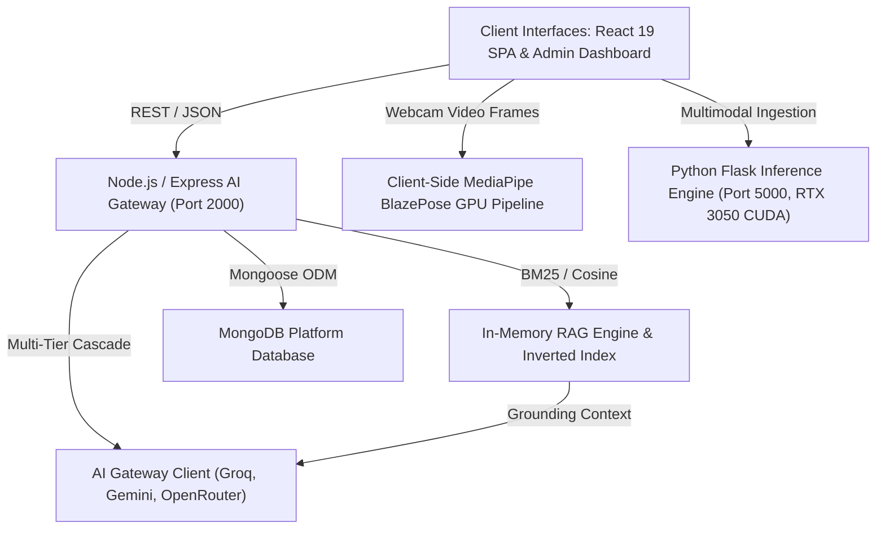

# Yogashrini Modernized Artificial Intelligence and Computer Vision Platform

## Comprehensive System Architecture and Feature Index

### Executive Overview

The Yogashrini Web Application has been transformed from a legacy static web portal into an intelligent, AI-augmented, and computer-vision-driven yogic health and education platform. The architecture integrates multi-tier large language model (LLM) orchestration, inverted index retrieval-augmented generation (RAG), real-time joint-angle biomechanical kinesiology, administrative decision intelligence, and GPU-accelerated pose estimation.

Each feature of this platform is modularized and accompanied by dedicated, research-grade architectural documentation and step-by-step implementation tutorials designed for both professional software engineers and young aspiring developers.

---

## Catalog of Implemented AI and Computer Vision Features

| Feature ID | Feature Name | Primary Subsystem | Documentation Path |
| :--- | :--- | :--- | :--- |
| **01** | Grounded RAG Chatbot with Citation Verification | Server (`services/rag_service.js`), Frontend (`Chatbot.tsx`) | [01_rag_yoga_chatbot/README_1.md](01_rag_yoga_chatbot/README_1.md) |
| **02** | Multi-Tier Clinical Movement Assessment and Report Generator | Server (`ai_controller.js`), Frontend (`UserDashboard.tsx`) | [02_smart_clinical_report_generation/README_2.md](02_smart_clinical_report_generation/README_2.md) |
| **03** | Real-Time Biomechanical Joint Analysis and Counter-Pose Engine | Server (`ai_controller.js`, `yoga_knowledge_base.json`) | [03_biomechanical_smart_analysis/README_3.md](03_biomechanical_smart_analysis/README_3.md) |
| **04** | Admin Executive Decision Intelligence and Growth Analytics | Server (`ai_controller.js`), Admin (`Dashboard.tsx`) | [04_admin_executive_ai_intelligence/README_4.md](04_admin_executive_ai_intelligence/README_4.md) |
| **05** | Adaptive Personalized Practice Sequence Synthesizer | Server (`ai_controller.js`), Frontend (`UserDashboard.tsx`) | [05_user_personalized_routine_synthesizer/README_5.md](05_user_personalized_routine_synthesizer/README_5.md) |
| **06** | Clinical Contraindication and Prop Modification Auditor | Server (`ai_controller.js`), Frontend (`UserDashboard.tsx`) | [06_contraindication_safety_scanner/README_6.md](06_contraindication_safety_scanner/README_6.md) |
| **07** | Real-Time MediaPipe Skeleton Tracker and GPU Posture Aligner | Frontend (`LiveTrainer.tsx`), Python Backend (`app.py`) | [07_computer_vision_pose_trainer/README_7.md](07_computer_vision_pose_trainer/README_7.md) |

---

## Architectural Topology

---

## Design and Quality Constraints

1. **Strict Exclusion of Emojis**: In accordance with enterprise software engineering and research publication standards, all user interfaces, dashboards, and technical documentation strictly omit pictographic emojis. Visual semantics are conveyed exclusively using scalable vector iconography via the `react-icons` suite.
2. **Deterministic Fallbacks**: All generative pipelines implement multi-tier fallback hierarchies, ensuring that network degradation or provider API rate limits gracefully resolve to local deterministic synthesis.
3. **Rigorous Dual-Depth Documentation**: Each feature documentation manual contains both a formal mathematical/algorithmic treatise for industry professionals and a step-by-step tutorial accessible to a 15-year-old student.
